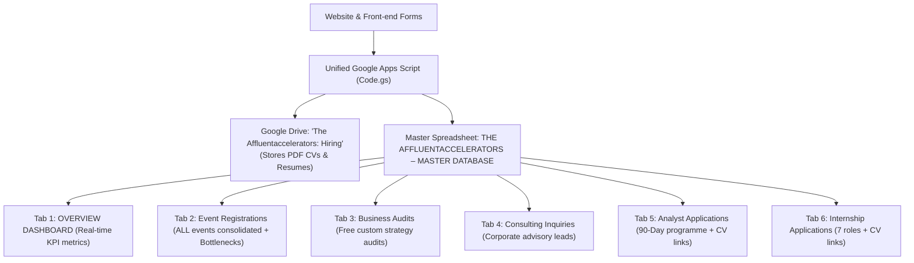

# 📊 The Affluentaccelerators – Unified Master Google Sheets & Apps Script Setup

## 🎯 Architectural Recommendation: Why Collapsing All Events into 1 Tab is Superior

You asked:
> *"Which do you think is better for me? I collapse all the event form into one sheet tab instead of multiple tabs for a more wholistic analysis of the different businesses and recurring requests or bottlenecks from all our registrations, then each request is indicated by an event name field and ID..."*

### Recommendation: Collapsing All Events into 1 Tab is 100% the Better Architecture

Here is why having a single **`Event Registrations`** tab with `Event ID` and `Event Name` columns is much better than splitting registrations across multiple tabs:

| Factor | Single Tab (`Event Registrations`) ✅ *(Recommended)* | Multiple Tabs per Event ❌ |
| :--- | :--- | :--- |
| **Wholistic Bottleneck Analysis** | **Instant Cross-Business Insights**: You can run 1 Pivot Table or search keyword trends across **all** attendees to see recurring bottlenecks (e.g. *working capital*, *sales channels*, *talent acquisition*). | **Data Silos**: Each event is locked in its own tab. Running cross-event summaries requires cumbersome multi-tab `=QUERY()` formulas. |
| **Recurring Request Tracking** | **Unified Demand Discovery**: Questions for guest speakers and specific requests across all cohorts sit in one column, revealing exactly what content or consulting services to launch next. | Questions are scattered across different tabs; hard to spot patterns. |
| **Future Event Maintenance** | **Zero Setup Needed**: Launching `EVENT 002`, `EVENT 003`, etc., requires **no new tabs** and **no script changes**. Every registration is simply tagged with its `Event ID` and `Event Name`. | Every new event requires creating, naming, and formatting a new sheet tab. |
| **Filtering & Slicing** | **1-Click Filter Views**: Need to view only attendees for `EVENT 001`? Just click the Google Sheets filter icon on the `Event ID` column, or create a Filter View. | You must switch between 10–20 tabs as your event history grows. |
| **CRM / Export Readiness** | Easy to export a single CSV for email newsletters, WhatsApp broadcasts, or CRM imports. | Must manually merge 10+ tabs before exporting. |

---

## 🏛️ Master Spreadsheet Architecture (Single Sheet, 6 Tabs)

Your entire organization's data now lives in **one** Google Spreadsheet:
**`THE AFFLUENTACCELERATORS – MASTER DATABASE`**



### Tab Breakdown & Key Diagnostic Columns

1. **`OVERVIEW DASHBOARD`**:
   - Executive KPI cards with dynamic `=COUNTA()` formulas: Total Event Registrations, Total Business Audits, Total Consulting Inquiries, and Total Career Applicants.
   - Live stream breakdown and recurring bottleneck tracking table.

2. **`Event Registrations`** *(Single Unified Tab for All Masterclasses & Webinars)*:
   - **`Event ID`** (e.g. `EVENT 001`, `EVENT 002`)
   - **`Event Name`** (e.g. `The Investable Business Playbook`)
   - `Registration ID` (e.g. `REG-EVT001-4921`)
   - `Registration Date` & `Sync Timestamp`
   - `Full Name`, `Email Address`, `Phone / WhatsApp Number`, `Country`, `City / State`
   - `Occupation / Category`, `Business Name`, `Business Description`, `Industry`
   - `Business Age`, `Business Stage`, `Monthly Revenue Range`
   - `Business Registration`, `Financial Records`, `Operational Systems`
   - **`Biggest Bottlenecks / Growth Challenges`** *(Key field for cross-business bottleneck diagnosis)*
   - `Business Priorities`, `Learning Expectations`
   - **`Question for Speaker / Specific Bottleneck Request`** *(Key field for recurring requests)*
   - `Consulting Interest`, `Playbook Interest`, `Investment-Readiness Interest`
   - `Attendance Status`, `Follow-up Status`

3. **`Business Audits`**:
   - `Reference ID`, `Submission Time`, `Full Name`, `Business Name`, `WhatsApp Number`, `Email Address`, `Industry`, `Current Business Stage`, `Business Description & Revenue Model`, `Current Bottleneck / Where Stuck`, `90-Day Growth Goal`, `Preferred Format (Video/Voice)`, `Status`.

4. **`Consulting Inquiries`**:
   - `Reference ID`, `Submission Time`, `Full Name`, `Business Name`, `Email Address`, `Phone Number`, `Industry`, `Location`, `Business Stage`, `Consulting Support Required`, `Key Challenges & Objectives`, `Business Overview`, `Uploaded Document (Drive Link)`, `Status`.

5. **`Analyst Applications`**:
   - `Reference ID`, `Submission Time`, `Full Name`, `Email Address`, `Phone Number`, `Location`, `Highest Qualification`, `Current Occupation`, **`CV / Resume (Drive Link)`**, `Motivation & Why This Programme`, `Areas of Consulting Interest`, `Career Goals`, `Tuition Readiness (₦175,000)`, `Status`.

6. **`Internship Applications`**:
   - `Reference ID`, `Submission Time`, `Full Name`, `Email Address`, `Phone Number`, `Location`, `Educational Background`, `Current Occupation`, `Preferred Role`, **`CV / Resume (Drive Link)`**, `Portfolio / Links`, `Key Skills`, `Availability`, `Relevant Experience`, `Motivation`, `Learning Goals`, `Status`.

---

## ⚡ 3-Minute Deployment Instructions

### Step 1: Open Your Master Google Spreadsheet
1. Open your master Google Sheet (or create a new one at [https://sheets.new](https://sheets.new)).
2. Name it:
   ```
   THE AFFLUENTACCELERATORS – MASTER DATABASE
   ```

### Step 2: Paste the Unified Apps Script
1. In the Google Sheets top menu, click **Extensions** > **Apps Script**.
2. Select all existing text in the editor, delete it, and copy the entire contents of:
   ```
   google-sheets-unified-script.js
   ```
3. Click the **Save** (diskette) icon.

### Step 3: Run the 1-Click Verification Test in Apps Script
1. In the toolbar at the top (next to "Debug"), select either:
   - **`testEventRegistrationForm`**: Quickly runs and verifies the Event Registration tab with sample data.
   - Or **`testUnifiedSetupAndSampleSubmissions`**: Sets up all 6 tabs and tests the entire system in 1 click.
2. Click **Run**.
3. Google will ask for permission on your first run:
   - Click **Review permissions**
   - Choose your Google Account
   - Click **Advanced** (bottom left)
   - Click **Go to project (unsafe)**
   - Click **Allow**
4. Check your Google Spreadsheet: The **`Event Registrations`** tab (and all 6 tabs) are automatically created, formatted with Deep Forest Green (`#06261b`) and Warm Gold (`#f3c74d`) headers, frozen rows, auto-resized columns, and populated with sample data!

### Step 4: Deploy as Web App
1. Click the blue **Deploy** button (top right) > **New deployment**.
2. Click the **Gear icon** next to "Select type" and choose **Web app**.
3. Configure the settings:
   - **Description**: `The Affluentaccelerators Unified Master Database`
   - **Execute as**: `Me (your email)`
   - **Who has access**: `Anyone` *(Crucial so front-end forms can post without login gates)*
4. Click **Deploy**.
5. Copy the **Web App URL** (ends in `/exec`).

### Step 5: Save Web App URL into Your Website
1. Open the Admin Portal: `https://.../admin.html`
2. Scroll to the **Unified Master Database Endpoint** section.
3. Paste your Web App URL into the input field and click **Save & Verify URL**.
4. The system will ping your script and confirm that all 6 tabs are online and connected!
