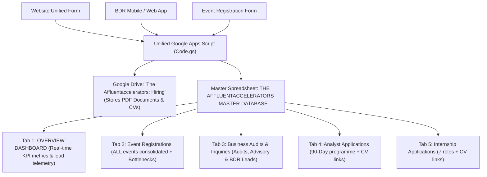

# 📊 The Affluentaccelerators – Unified Master Google Sheets & Apps Script Setup

## 🎯 Architecture: Consolidated Audits & Inquiries + BDR Lead Tracking

You requested to collapse the **Business Audit** and **Consulting Inquiry** forms into one unified form and database track:
> *"now I would love to collapse the audit and inquiry for together, since they have similar questions, let's make it one form for both track but a drop down select that changes if it's a free audit they're looking for or an indepth enquiry, I think they're quite the same, so we definitely might need to delete one of those tabs on the Google sheets and also the general submission tab, because we also have another input source from our app where BDR can also submit forms in these enquiries, so we want to just be able to track the source, either from our free audit track, the consult/inquiry, or an agent filed it in as a new lead, so let unique form include their business location, team size and web or social URL if it doesn't already include them"*

### Why Consolidating Audits & Inquiries into 1 Tab is Superior

| Benefit | Unified `Business Audits & Inquiries` Tab ✅ | Separate Tabs (Old System) ❌ |
| :--- | :--- | :--- |
| **Omnichannel Lead Tracking** | Track whether each lead originated from **Website - Free Audit Track**, **Website - In-Depth Inquiry**, or was filed in the field by an agent via the **BDR App**. | Inquiries and audits were split into separate silos, making lead tracking fragmented. |
| **Complete Commercial Profile** | Every lead now consistently captures **Business Location**, **Team Size / Employees**, and **Website / Social Media URL**. | Fields were inconsistent (Audit lacked location and team size; Inquiry lacked preferred format). |
| **Streamlined Clean Sheets** | Deletes redundant old tabs (`Business Audits`, `Consulting Inquiries`, `General Submissions`) leaving **5 purpose-built tabs**. | Cluttered spreadsheet with multiple redundant tabs. |
| **BDR App Direct Ingestion** | Sales reps & BDRs can submit in-field leads directly to this exact same webhook with their agent tag in `source`. | Separate scripts and webhooks required for field agents. |

---

## 🏛️ Master Spreadsheet Architecture (Single Sheet, 5 Tabs)

Your entire organization's data now lives in **one** Google Spreadsheet:
**`THE AFFLUENTACCELERATORS – MASTER DATABASE`**



### Tab Breakdown & Diagnostic Columns

1. **`OVERVIEW DASHBOARD`**:
   - Real-time KPI cards: Total Event Registrations, Total Audits & Inquiries, Free Audits vs In-Depth ratio, and Career Candidates.
   - Live stream breakdown and recurring bottleneck tracking table.

2. **`Event Registrations`** *(Single Unified Tab for All Masterclasses & Webinars)*:
   - `Event ID`, `Event Name`, `Registration ID`, `Registration Date`, `Full Name`, `Email Address`, `Phone / WhatsApp Number`, `Country`, `City / State`, `Occupation / Category`, `Business Name`, `Business Description`, `Industry`, `Business Age`, `Business Stage`, `Website / Social Link`, `Number of Employees`, `Monthly Revenue`, `Biggest Bottlenecks / Growth Challenges`, `Question for Speaker / Specific Bottleneck Request`, `Consulting Interest`, `Status`.

3. **`Business Audits & Inquiries`** *(NEW Consolidated Lead Tab)*:
   - **`Reference ID`** (e.g. `INQ-4821`, `AUD-1042`, `BDR-9302`)
   - **`Submission Time`**
   - **`Submission Track`** (`One-Time Free Audit`, `Paid In-Depth Strategy & Review`, `BDR / Agent In-Field Lead`)
   - **`Lead Source`** (`Website - One-Time Free Audit Track`, `Website - Paid In-Depth Strategy Track`, `BDR App: Agent Name`, `Trade Expo`, etc.)
   - **`Full Name`**
   - **`Business Name`**
   - **`WhatsApp Number`**
   - **`Work Email Address`**
   - **`Industry / Sector`**
   - **`Business Location`** *(e.g. Lagos, Nigeria / Nairobi / London)*
   - **`Team Size`** *(e.g. 1 Person, 2–5, 6–20, 21–50, 51–200, 200+)*
   - **`Website or Social URL`** *(e.g. https://company.com, LinkedIn, Instagram)*
   - **`Current Business Stage`** *(Pre-Revenue, Early Sales, Consistent Revenue, Scaling SME, Enterprise)*
   - **`What Business Does & Revenue Model`**
   - **`Core Bottleneck / Current Struggles`**
   - **`Primary Goal / 90-Day Priority`**
   - **`Consulting Support Required`**
   - **`Preferred Audit Format`**
   - **`Uploaded Document (Drive Link)`** *(Pitch deck / company brief)*
   - **`Additional / BDR Notes`**
   - **`Lead Status`** (`New Lead`, `Audit Dispatched`, `Consultant Assigned`, `Closed - Won`)
   - **`Assigned Consultant / BDR`**
   - **`Sync Timestamp`**

4. **`Analyst Applications`**:
   - Full Name, Email, Phone, Location, Qualification, Occupation, **`CV / Resume (Drive Link)`**, Motivation, Goals, Tuition Readiness (₦175,000), Status.

5. **`Internship Applications`**:
   - Full Name, Email, Phone, Location, Education, Occupation, Preferred Role, **`CV / Resume (Drive Link)`**, Portfolio, Skills, Availability, Status.

---

## ⚡ 1-Click Tab Consolidation & Obsolete Tabs Deletion

The script includes an automated migration and cleanup engine.

### How to Clean Up Your Sheet in 10 Seconds:
1. Open your master Google Sheet.
2. In the top menu, click **Extensions** > **Apps Script**.
3. Replace the code in editor with the latest `google-sheets-unified-script.js`. Click **Save** 💾.
4. In the top toolbar dropdown (next to "Debug"), select:
   ```
   testAuditAndInquiryConsolidation
   ```
5. Click **Run** ▶️.

**What Happens Automatically:**
- Creates the consolidated **`Business Audits & Inquiries`** tab with all 23 columns.
- Migrates any rows from your old **`Business Audits`** and **`Consulting Inquiries`** tabs into the new tab so no leads are lost.
- Permanently deletes the old **`Business Audits`** and **`Consulting Inquiries`** tabs.
- Permanently deletes any obsolete **`General Submissions`**, **`General Submission`**, or **`Submissions`** tab.
- Submits 3 sample verification rows (Free Audit track, Consulting Inquiry track, and BDR In-Field Lead track).
- Refreshes your **`OVERVIEW DASHBOARD`**.

---

## 📱 BDR Mobile / Web App Integration Guide

Your Business Development Representatives (BDRs) and field agents can submit prospect inquiries directly into this database from their internal app.

### API Endpoint:
Use your deployed Apps Script Web App URL:
```
POST https://script.google.com/macros/s/AKfycbzIwLdLmzRJVPJAyrrLwLDCYgsiOmZAR3-SjYG_CllDA17xgCITuCYFKwIOWdsZj8w/exec
```

### JSON Request Payload:
```json
{
  "action": "submit_lead",
  "formType": "audit-inquiry",
  "track": "BDR / Agent In-Field Lead",
  "source": "BDR App - Agent Adeola",
  "data": {
    "name": "Adeola Adeleke",
    "businessName": "Zenith Agro-Allied Processing",
    "whatsapp": "+234 803 123 4567",
    "email": "adeola@zenithagro.ng",
    "industry": "Agriculture & Agribusiness",
    "location": "Ibadan, Oyo State, Nigeria",
    "teamSize": "21 – 50 Employees (Established SME)",
    "website": "https://instagram.com/zenithagrouk",
    "stage": "Scaling SME ($100k - $1M/yr)",
    "description": "Grain processing and wholesale distribution to commercial FMCG buyers.",
    "struggles": "Receivables delay from distributors causing acute working capital friction.",
    "goal": "Restructure distribution contracts and optimize cash flow cycle.",
    "supportType": "Operations & Systems Optimization",
    "bdrNotes": "Met founder at South-West Trade Fair. Requested executive briefing within 48 hours."
  }
}
```

### JavaScript / React Native Example:
```javascript
async function submitBdrLead(leadInfo, agentName) {
  const WEBHOOK_URL = "https://script.google.com/macros/s/AKfycbzIwLdLmzRJVPJAyrrLwLDCYgsiOmZAR3-SjYG_CllDA17xgCITuCYFKwIOWdsZj8w/exec";
  
  const payload = {
    action: "submit_lead",
    formType: "audit-inquiry",
    track: "BDR / Agent In-Field Lead",
    source: `BDR App: ${agentName}`,
    data: {
      name: leadInfo.founderName,
      businessName: leadInfo.companyName,
      whatsapp: leadInfo.whatsappNumber,
      email: leadInfo.emailAddress,
      industry: leadInfo.industry,
      location: leadInfo.location,
      teamSize: leadInfo.teamSize,
      website: leadInfo.websiteUrl,
      stage: leadInfo.businessStage,
      description: leadInfo.businessOverview,
      struggles: leadInfo.coreChallenge,
      supportType: leadInfo.supportInterest,
      bdrNotes: leadInfo.fieldNotes
    }
  };

  const response = await fetch(WEBHOOK_URL, {
    method: "POST",
    headers: { "Content-Type": "text/plain;charset=utf-8" },
    body: JSON.stringify(payload)
  });

  return await response.json();
}
```

### cURL Example:
```bash
curl -X POST "https://script.google.com/macros/s/AKfycbzIwLdLmzRJVPJAyrrLwLDCYgsiOmZAR3-SjYG_CllDA17xgCITuCYFKwIOWdsZj8w/exec" \
  -H "Content-Type: text/plain;charset=utf-8" \
  -d '{
    "action": "submit_lead",
    "formType": "audit-inquiry",
    "track": "BDR / Agent In-Field Lead",
    "source": "BDR App - Agent Michael",
    "data": {
      "name": "Kunle Adebisi",
      "businessName": "Ade-Kunle Transport Logistics",
      "whatsapp": "+2348021112233",
      "email": "kunle@ade-kunle.com",
      "industry": "Logistics, Supply Chain, Freight & Transport",
      "location": "Lagos, Nigeria",
      "teamSize": "6 – 20 Employees",
      "website": "https://ade-kunle.com",
      "stage": "Consistent Revenue ($10k - $100k/yr)",
      "description": "Interstate haulage and freight dispatch.",
      "struggles": "Fleet maintenance overheads and unstandardized dispatch SOPs.",
      "supportType": "Operations & Systems Optimization",
      "bdrNotes": "Follow up scheduled for Thursday 2pm."
    }
  }'
```

---

## 🚀 Live Website Verification

View your live website with the collapsed, adaptive form:
👉 **[Open Website Preview](https://antigravity.luch.dev/site/cc4afaf2-23df-4a93-a726-589d1ffb2d9c/1357de481731c84ee260bf7f/)**
